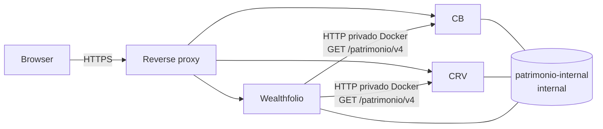

# Plano de execução: CB + CRV + Wealthfolio e retirada do NetWorth

**Estado:** em execução com autorização explícita do mantenedor. A retirada do
NetWorth continua condicionada ao Gate D.

**Decisão:** Controle Bancário (CB) e Controle de Renda Variável (CRV) continuam como fontes operacionais de verdade. Wealthfolio v3.9.1, iniciado sem dados, passa a ser a interface gerencial. NetWorth é um experimento nunca usado em produção; será preservado apenas como repositório e referência até a primeira operação comprovada do Wealthfolio e então removido do VPS.

## 1. Limites de responsabilidade

| Sistema | Responsabilidade | Fora de escopo |
| --- | --- | --- |
| CB | contas, lançamentos, recorrências, transferências e projeção de caixa | gravar dados no Wealthfolio |
| CRV | posições, cotações, proventos recebidos e movimentos | gravar dados no Wealthfolio |
| Wealthfolio | leitura gerencial de patrimônio, alocação e acompanhamento de snapshots | lançamento operacional, replicação de fatos de caixa e trades |
| NetWorth | referência de código durante a retirada | receber dados reais, desenvolver telas ou manter serviço ativo depois do aceite |

O conector usa snapshots. Ele não cria atividades de compra, venda, dividendo ou transferência no Wealthfolio. Ausência de cobertura é exibida como ausência; nunca é convertida em zero. CB e CRV são fontes separadas: a consolidação deve registrar a data e a idade de cada fonte, pois não existe uma transação distribuída entre as duas bases.

## 2. Estado técnico já disponível

- CB e CRV publicam `GET /patrimonio/v4/metadata`, `snapshot` e `changes` de somente leitura.
- O feed `changes` é de invalidação: após alteração, o conector busca outro snapshot consistente; ele não reconstrói fatos a partir de eventos.
- O add-on `controle-patrimonial-sync` importa caixa do CB e posições do CRV, guarda tokens no secret store e confirma cursor somente após aplicação bem-sucedida.
- O add-on tem sincronização inicial e periódica enquanto seu runtime estiver ativo; execuções concorrentes são coalescidas.
- Os três serviços possuem overrides para a rede Docker externa e interna `patrimonio-internal`; CB e CRV recebem os aliases `cb-api` e `crv-api`.
- Wealthfolio é greenfield, usa volume próprio, banco criptografado e expõe a porta apenas em loopback no Compose base.

### Registro de execução

| Data (UTC) | Ação | Evidência | Resultado |
| --- | --- | --- | --- |
| 2026-09-28 | Restore point de produção | `backup-db.sh --forcar` no VPS | Dumps validados para CB, CRV e NetWorth, publicados às 17:11 UTC. |
| 2026-09-28 | Contrato v4 CB | PR #95, commit `a6e5f9f` | Quality Docker e CI aprovados; implantado e saudável. |
| 2026-09-28 | Contrato v4 CRV | PR #87, commit `d5a9775` | Quality Docker e CI aprovados; implantado e saudável. |
| 2026-09-28 | NetWorth | verificação de estado e health | Permanece no commit `f024e12`, saudável e sem alteração de dados. |
| 2026-09-28 | Observabilidade do add-on | build `compose.addon-build.yaml` | Estados por fonte, cursor e falha sanitizada implementados; revisão final em andamento para a extensão de tipo de instrumento. |

## 3. Arquitetura de operação no VPS

O HTTPS atende navegador e proxy reverso. O tráfego máquina a máquina usa DNS Docker na rede interna. Os serviços continuam conectados às redes próprias necessárias para seus bancos; a rede de patrimônio não é usada para expor bancos nem portas ao host.

## 4. Sequência de execução e gates

### Fase A — preparação reproduzível

1. Conferir os commits dos contratos v4, do add-on e dos overrides de rede nos três repositórios.
2. Conferir que arquivos `.env`, chaves, tokens e hashes permanecem fora de Git e que os exemplos não contêm segredo.
3. Definir os nomes reais dos serviços do VPS e o local seguro do arquivo de chave mestre do Wealthfolio.
4. Criar uma ficha de implantação com versão da imagem, hash do ZIP do add-on, data, operador e resultado de cada gate.

**Gate A:** configuração Docker validada pelos comandos oficiais dos repositórios; nenhuma mudança em VPS ainda.

### Fase A.0 — observabilidade de sincronização

O add-on atual mantém `generated_at` e `high_watermark` durante a execução, porém a tela de importação mostra apenas uma mensagem da sessão. Antes de o painel ser usado, o add-on precisa persistir e exibir, separadamente para CB e CRV:

- horário da última sincronização bem-sucedida;
- `snapshot_id`, `generated_at` e `high_watermark` aplicados;
- estado `atual`, `desatualizado`, `falhou` ou `ainda não sincronizado`;
- mensagem de falha sanitizada, sem token, URL com credencial ou payload sensível.

Uma falha em CRV depois de uma atualização válida de CB é um resultado parcial observável. O add-on não deve ocultá-lo com um status global de sucesso. A interface precisa mostrar os dois estados e permitir nova tentativa segura. Essa mudança preserva a semântica atual de snapshots e não cria sincronização distribuída.

**Gate A.0:** par de integração confirma persistência por fonte, reprocessamento idempotente, mensagem sem segredo e exibição de fonte desatualizada. O pacote do add-on é recompilado e verificado antes de seguir.
### Fase A.1 — lacunas da automação de VPS

A análise da automação atual identificou três ajustes necessários antes da implantação:

1. O `deploy.sh` de manutenção usa somente `-f compose.yaml`. Ele precisa carregar de forma persistente os overrides `compose.patrimonio-internal.yaml` de CB, CRV e Wealthfolio; sem isso, um deploy posterior pode desconectar os aliases privados.
2. O health check de Wealthfolio deve testar `/api/v1/healthz` e sua resposta real. O check JSON usado por CB e CRV não pode ser reutilizado por suposição.
3. O Nginx precisa criar vhost HTTPS próprio para Wealthfolio, com limite de tentativas também para `POST /api/v1/auth/login`. A rota atual limitada de outros sistemas não cobre automaticamente esse login.

Esses ajustes são uma mudança de infraestrutura versionada. Eles serão implementados e revisados localmente antes de qualquer comando no VPS.

**Gate A.1:** build/configuração dos Compose, Nginx e rotina de deploy aprovados pelo par de infraestrutura; cada health check confirma o formato de resposta do serviço correspondente.
### Fase B — primeiro Wealthfolio sem dados

1. Criar a rede `patrimonio-internal` como rede Docker `--internal`, uma única vez no VPS.
2. Subir Wealthfolio com seu volume exclusivo vazio, chave mestre externa montada somente leitura, senha Argon2id e porta limitada ao proxy/loopback conforme a topologia real.
3. Aplicar os overrides de rede aos serviços web de CB e CRV, preservando as redes existentes de cada aplicação.
4. Criar tokens de leitura exclusivos para a integração, quando o modelo de token da fonte permitir; registrar identificadores, nunca valores.
5. Instalar o ZIP do add-on pela interface do Wealthfolio e configurar os dois destinos internos exatos: `http://cb-api:8000/patrimonio/v4` e `http://crv-api:5003/patrimonio/v4`.
6. Desabilitar sincronização entre dispositivos do Wealthfolio enquanto o add-on usar armazenamento local de checkpoint.

**Gate B:** health checks dos três serviços verdes; o add-on acessa somente os dois hosts literais; o banco do Wealthfolio ainda contém apenas o estado criado pela integração.

### Fase C — conciliação inicial dirigida

1. Executar uma sincronização manual do add-on.
2. Comparar manualmente, por amostragem documentada, saldo de contas CB, posições CRV, preços, proventos recebidos e moeda contra o Wealthfolio.
3. Alterar um lançamento de teste controlado no CB e uma posição ou provento de teste no CRV; confirmar que o feed invalida e o snapshot seguinte converge.
4. Repetir a sincronização sem mudanças e confirmar que não há duplicação de contas, posições, snapshots ou atividades.
5. Reiniciar apenas o Wealthfolio e confirmar que o checkpoint persiste e uma nova sincronização permanece idempotente.
6. Conferir e registrar `generated_at`, `high_watermark` e idade de cada fonte. Quando uma fonte estiver atrasada ou indisponível, o painel deve expor estado degradado e a data da última atualização; não deve apresentar a consolidação como atômica.
7. Registrar os limites conhecidos: CRV não fornece negócios completos retroativos e não fornece previsão de proventos anunciados; o Wealthfolio não deve inferir esses valores.

**Gate C:** conciliação aprovada pelo operador, repetição idempotente confirmada e nenhum dado operacional criado no Wealthfolio.

### Fase D — uso gerencial assistido

1. Usar Wealthfolio como painel gerencial para consultas reais, mantendo toda digitação no CB e no CRV.
2. Monitorar erros de sincronização, atrasos, divergências e saúde dos contêineres.
3. Corrigir apenas defeitos encontrados no fluxo observado, cada um seguindo o processo de pares abaixo.
4. Manter o NetWorth sem receber dados reais e sem novas funcionalidades.

**Gate D:** pelo menos uma conciliação operacional real concluída e o Wealthfolio é considerado utilizável como painel gerencial.

### Fase E — retirada do NetWorth de teste

Esta fase fica autorizável depois do Gate D, pois o NetWorth não contém histórico nem fluxo de produção a migrar.

1. Inventariar serviço Compose, proxy reverso, volumes, timers, variáveis e DNS associados ao NetWorth no VPS.
2. Criar um backup pontual verificável do banco de teste, se ele existir, e preservar o repositório Git, `LICENSE` e `NOTICE.md`.
3. Remover o vhost do NetWorth do bundle de Nginx, executar a validação oficial do Nginx e parar a stack sem usar `down -v`.
4. Desabilitar `atualizar-cambio.timer` e `registrar-foto.timer` e confirmar que o instalador central não recriará o vhost ou os timers.
5. Conferir que CB, CRV e Wealthfolio não referenciam hostname, token, volume ou timer do NetWorth.
6. Manter contêineres parados e volumes identificados por sete dias como janela de reversão técnica. Depois de nova inspeção por nome e labels, remover contêineres e volumes; revogar credenciais de integração caso existam. Certificados compartilhados somente são removidos depois de confirmar seus consumidores.

**Critério de retirada:** Gate D aprovado + inventário sem consumidores + backup pontual concluído. A retirada de tráfego e timers acontece no aceite; a exclusão irreversível dos volumes ocorre depois de sete dias. Não há janela mínima de migração porque o NetWorth jamais foi produtivo.

## 5. Funcionalidade futura: projeção consolidada

A projeção não bloqueia o go-live. Ela será tratada como fase posterior e independente.

| Dado | Fonte definitiva | Contrato necessário |
| --- | --- | --- |
| caixa atual, lançamentos futuros e recorrências | CB | reutilizar `GET /patrimonio/v3/projection` com semântica documentada |
| posição atual | CRV | `patrimonio/v4/snapshot` |
| proventos futuros anunciados | CRV | novo endpoint explícito de previsão, com status, revisão, datas, valor e moeda; proventos recebidos não substituem previsão |
| apresentação consolidada | add-on ou serviço analítico privado | contrato de projeção versionado, somente leitura e com cobertura declarada |

A regra de cálculo do CB permanece no CB. A futura tela gerencial apenas consome contratos publicados. Nenhum cálculo será copiado para o Wealthfolio sem contrato, cobertura, timezone, moeda, regra de arredondamento e tratamento de ausência definidos.

## 6. Coordenação de subagents e prevenção de corridas

O trabalho será executado em pares sob coordenação do agente principal. Nenhum subagent recebe autorização para alterar VPS, publicar, remover recursos, trocar segredos ou decidir escopo.

| Item | Agente executor | Revisor adversarial | Regra de serialização |
| --- | --- | --- | --- |
| Configuração e instalação do Wealthfolio | perfil integração/add-on | perfil segurança e idempotência | revisor começa após o executor congelar o diff e seus artefatos |
| Compose, rede e proxy | perfil infraestrutura | perfil isolamento e rollback | somente um executor grava os arquivos de infraestrutura por vez |
| Conciliação CB/CRV | perfil contratos e domínio financeiro | perfil qualidade de dados | revisão usa cópias das respostas e não altera fontes |
| Retirada do NetWorth | perfil operação e inventário | perfil dependências e preservação | nenhuma exclusão antes de checklist assinado pelo coordenador |
| Projeção futura | perfil domínio CB/CRV | perfil contratos e casos de fronteira | inicia apenas depois de estabilizar a fase D |

Cada item segue esta ordem obrigatória:

1. Eu delimito arquivos, serviço alvo, resultado esperado e comando oficial de validação.
2. Um único executor trabalha no item; os demais ficam somente em leitura.
3. O executor entrega diff, riscos e evidência de validação.
4. O revisor analisa o estado congelado com um viés diferente e produz achados reproduzíveis.
5. Eu consolido os achados, mando correções sequenciais e valido o resultado final.
6. Somente após aceite do gate o próximo item é liberado.

Para reduzir corridas, agentes não editam o mesmo repositório ou arquivo em paralelo. Mudanças interdependentes em CB, CRV e Wealthfolio seguem ordem de contrato: fonte, consumidor, infraestrutura. Revisores não corrigem diretamente o diff durante sua análise; eles reportam para o executor ou para mim.

## 7. Validação e reversão

| Situação | Ação de reversão |
| --- | --- |
| Add-on falha ou diverge | desabilitar/remover add-on; CB e CRV continuam íntegros |
| Wealthfolio falha | parar somente o Compose do Wealthfolio; preservar volume e chave para análise |
| Rede interna falha | restaurar override anterior dos serviços; não abrir APIs públicas como correção rápida |
| Conciliação não fecha | manter Wealthfolio somente em observação; não editar dados para forçar igualdade |
| Retirada do NetWorth encontra dependência | restaurar serviço a partir do inventário e adiar exclusão |

Os testes são executados exclusivamente pelos serviços Docker e comandos oficiais de cada repositório. A ficha de implantação deve separar verificações de configuração, build, health check, sincronização, conciliação e rollback.

## 8. Aprovação necessária antes de executar

A aprovação final deve confirmar:

- início da Fase A e B no ambiente alvo;
- janela para aplicar Compose e proxy no VPS;
- uso de dados reais de CB e CRV somente na conciliação dirigida;
- retirada do NetWorth depois do Gate D;
- manutenção do repositório NetWorth e seus avisos de licença após a retirada do serviço.
